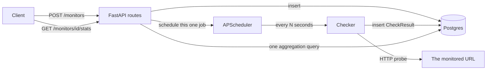

# 00 — Orientation

Before any code: what is this thing, and what shape is it?

## The product in one paragraph

You register a **monitor** — a URL, an HTTP method, the status code you expect, and how
often to check. DevPulse then probes that URL on schedule, forever, and writes down what
happened every single time: the status code, how many milliseconds it took, whether it
counted as a success, and if not, why. You can then ask it for the raw history
(`GET /monitors/{id}/results`) or for aggregate statistics
(`GET /monitors/{id}/stats`) — uptime percentage, average latency, how many outages.

That's it. It is a small product, deliberately. What makes it worth studying is that it
contains one of almost everything a real backend has: a database with migrations, an
authenticated HTTP API, background work on a schedule, outbound network calls that fail in
interesting ways, and a test suite that runs without any of that infrastructure present.

## The loop



Two things are worth noticing in that diagram.

First, **the API and the scheduler talk to each other.** When you create a monitor, the
route doesn't just write a row and hope some background process notices — it directly tells
the scheduler to start that specific job. When you change the interval, the route
reschedules that specific job. When you delete, it removes that specific job. Chapter 08
covers why "that specific job" is doing a lot of work in those sentences.

Second, **the stats query is an arrow to the database, not a loop in Python.** Computing
uptime over a month could mean pulling 43,000 rows into memory and counting them. It
doesn't. Chapter 14 is entirely about that decision.

## It all runs in one process

> 🔑 **Decision:** The scheduler runs *inside* the web application process, rather than as
> a separate worker service (Celery, RQ, a cron container).

The build plan is explicit that this is to stay deployable on free hosting tiers — one
process, one service, no message broker, no second dyno. The plan's deployment note spells
out the consequence in the same breath: *"the scheduler lives inside the web process
(deliberate, to stay on free tiers). Run **one** instance."*

That's the trade-off stated honestly. If you ran two copies of this app for redundancy,
both would schedule the same monitors and you'd get double the checks. The architecture
buys simplicity and cheapness, and pays for it with a hard limit of one instance. Knowing
*which* constraint you bought is the whole point of writing decisions down — a future you
who wants horizontal scaling knows exactly what has to change first.

## The three tables

Everything persists into three tables:

- **`users`** — an account. Has an email and an API key. That's all; there are no
  passwords in this system (chapter 10 explains why, twice).
- **`monitors`** — a check definition owned by a user. URL, method, expected status,
  interval, headers, active flag.
- **`check_results`** — one row per probe, forever. This is the append-only fact table
  that everything interesting is computed from.

The relationship is a simple tree: a user has many monitors, a monitor has many check
results. Deleting flows downward — chapter 04 covers how that deletion is arranged so it
doesn't drag thousands of rows through Python to do it.

## Repo map

```
app/
  main.py          # app factory + lifespan: where everything is wired together
  config.py        # Settings (env-driven)
  logging.py       # structlog setup
  models.py        # the three tables (SQLAlchemy ORM)
  database.py      # engine construction + per-request session
  schemas.py       # Pydantic request/response shapes (NOT the tables)
  dependencies.py  # auth + scheduler injection
  routers/
    users.py       # POST /users
    monitors.py    # monitors CRUD + /results + /stats
  services/
    checker.py     # performs one HTTP probe, records the outcome
    scheduler.py   # owns APScheduler, one job per monitor
alembic/           # database migrations
tests/             # 53 tests, no network, no Postgres needed
docs/
  study-guide/     # you are here
  superpowers/plans/  # the original build plans, with rationale
```

Two directories deserve a note.

`app/services/` holds things that do work on their own — probing, scheduling. `app/routers/`
holds things that answer HTTP requests. The split matters because the checker and scheduler
have to be usable *without* an HTTP request in flight (a scheduled job has no request), so
they can't depend on anything request-scoped.

`docs/superpowers/plans/` is unusual and valuable: the full implementation plans, written
before the code, including their reasoning. Most of this guide is distilled from them.

## How it was built (and why the chapters are in this order)

The project was built in eight planned tasks, each one test-first, each one a single
commit:

| Task | Commit | What it added |
|------|--------|---------------|
| 1 | `a155fb0` | Scaffolding, settings, logging |
| 2 | `d46b6f0` | ORM models + database layer |
| 3 | `4adec21` | Alembic + initial migration |
| 4 | `150332b` | The HTTP checker |
| 5 | `4935649` | The scheduler |
| 6 | `e25e578` | Schemas + user registration |
| 7 | `cb41da1` | Auth + monitors CRUD |
| 8 | `e1357db` | Lifespan wiring, entrypoint, smoke test |

Then came the fixes and additions that make up the interesting half of this guide:
`0c9e939`, `10b7260`, `7283069`, `46c6a53`, `46d046b`, and finally the stats endpoint in
`bc329d9`.

This guide's chapters follow that same order. The build order is not arbitrary: notice that
nothing can be *assembled* (task 8) until all the parts exist, and that the parts were
built bottom-up — configuration before models, models before the things that query them,
the checker before the scheduler that calls it. Each layer only knows about layers below
it. That property is what makes the codebase readable, and it's what makes this reading
order work.

### 🔍 Try it

1. **See the shape of the thing.** From the repo root, with your venv active:

   ```bash
   pytest -q
   ```

   53 tests, well under a second. Sit with that for a moment — this suite starts a web app,
   creates a database schema, and exercises an HTTP API, and it does it faster than you can
   read this sentence. Chapter 13 is about how.

2. **Read the commit list as a story:**

   ```bash
   git log --oneline
   ```

   Read it bottom to top. That's the order things came into existence, and the order you're
   about to study them in.

3. **Peek at the original plan's decision list** — the first 40 lines record choices that
   were made *before any code was written*:

   ```bash
   head -40 docs/superpowers/plans/2026-08-07-devpulse-monitoring-engine.md
   ```

   You won't understand all of it yet. That's fine — chapter 01 unpacks it.

---

Next: [01 — The stack](01-stack.md)
