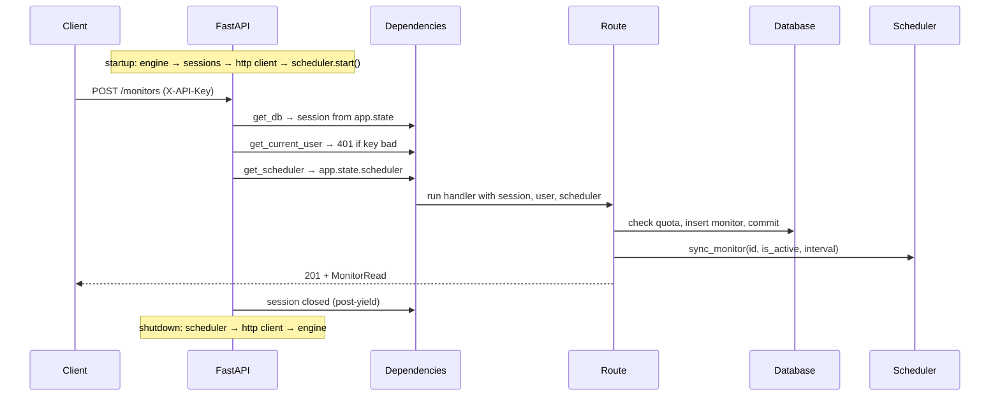

# 12 — Lifespan: where it's all assembled

File: `app/main.py`, 78 lines. Every chapter so far described a part. This is the file that
builds them, connects them, and takes them apart again — and it's where a resource leak
hid.

## The problem lifespan solves

The app needs three things that must exist before the first request and be cleaned up after
the last: a database engine (a connection pool), an HTTP client (another connection pool),
and a running scheduler.

Module-level globals can't do this. An engine created at import time opens connections when
the file is *imported* — including when your test suite imports it, when a migration script
imports it, when your editor's linter imports it. And nothing ever closes them.

```python
@asynccontextmanager
async def lifespan(app: FastAPI) -> AsyncIterator[None]:
    ...setup...
    yield
    ...teardown...
```
`app/main.py:20-54`

> ⚙️ **FastAPI note:** Everything before `yield` runs once at startup; the app then serves
> requests; everything after runs once at shutdown. It's the `yield` pattern from chapter
> 02, scoped to the application's whole life instead of one request.

> 🔑 **Decision: lifespan, not `@app.on_event("startup")`.** The old decorator-pair API is
> deprecated. It also separates setup from teardown into two functions, so a resource
> created in one has to be stashed somewhere global for the other to find. Lifespan keeps
> both halves in one function where `engine` is just a local variable — and that's exactly
> what makes the `finally` block below possible.

## The assembly order

```python
settings = get_settings()
engine = build_engine(settings.database_url, echo=settings.echo_sql)
session_factory = async_sessionmaker(engine, expire_on_commit=False)
http_client = httpx.AsyncClient(timeout=settings.http_timeout_seconds, follow_redirects=True)
scheduler = MonitorScheduler(session_factory, http_client)
```
`app/main.py:31-37`

Read it as a dependency chain, each line consuming the one above: settings → engine →
sessions → HTTP client → scheduler. The scheduler is last because it needs both the session
factory (to load monitors and write results) and the HTTP client (to probe).

This is the only place in the codebase where these objects are *constructed*. Everything
else receives them. That's why chapter 07's checker takes a `client` parameter and chapter
08's scheduler takes a `session_factory` — the components declare what they need and this
file supplies it. The pattern has a name (dependency injection, done by hand) and a
practical benefit: every one of those components can be built in a test with a different
argument.

## `app.state`: the handoff

```python
app.state.engine = engine
app.state.session_factory = session_factory
app.state.scheduler = scheduler
```
`app/main.py:39-41`

`app.state` is a bag of attributes on the FastAPI application object, and it's how these
locals become reachable from request handlers. The two dependencies that read it:

```python
session_factory = request.app.state.session_factory   # app/database.py:63
return request.app.state.scheduler                    # app/dependencies.py:42
```

Every request carries a reference to its app, so every request can reach the resources
created at startup. No globals, no singletons, no import-time side effects — and because
the values live on *an* app rather than *the* app, a test can build a different app with
different values.

## <a id="war-story-c3"></a>💥 War story C3: the startup failure that leaked both pools

**Commit `10b7260`.**

Here's the current code:

```python
started = False
try:
    await scheduler.start()
    started = True
    logger.info("app_started")
    yield
finally:
    if started:
        await scheduler.shutdown()
    await http_client.aclose()
    await engine.dispose()
    logger.info("app_stopped")
```
`app/main.py:43-54`

**What it looked like before.** `await scheduler.start()` was *outside* the `try`. Which
seems reasonable — you start the scheduler, and then you protect the serving phase.

**What broke.** Chapter 08 showed that `scheduler.start()` queries the database for active
monitors. So if the database is unreachable at boot — a Neon instance still waking, a bad
`DATABASE_URL`, a network blip — `start()` raises. And because it raised *before* the
`try`, the `finally` never ran. The exception propagated out of the lifespan and startup
failed, leaving behind an `httpx.AsyncClient` and a SQLAlchemy engine with their connection
pools open and no reference to close them.

Worse in the environment it targets: a platform that restarts a crashed service in a loop
leaks a fresh pair of pools per attempt.

**The fix, in two parts.** Move `scheduler.start()` inside the `try` so the `finally` always
runs. Then note the new problem that creates: if `start()` failed, calling
`scheduler.shutdown()` in cleanup would fail too — shutting down something never started —
and that second exception would mask the first, hiding the real cause.

Hence the `started` flag. Shutdown is conditional on having started; closing the client and
disposing the engine is unconditional, because those objects definitely exist.

The reasoning is now in the docstring where the next reader will find it
(`app/main.py:26-29`): *"`scheduler.start()` runs inside the `try` so that a startup failure
(e.g. an unreachable database) still closes the HTTP client and disposes the engine instead
of leaking their connection pools."*

> **The lessons.** *Everything acquired before the `try` must be released in the `finally`,
> and the `try` must start immediately after the last acquisition.* The gap between "I have
> a resource" and "I have a cleanup handler for it" is where leaks live.
>
> Second: **cleanup must be conditional on what actually succeeded.** A `finally` that
> assumes full setup will throw during a partial failure — and an exception thrown while
> handling an exception replaces the interesting error with a boring one. The `started`
> flag exists purely so the real failure reaches the logs.

## The application factory

```python
def create_app() -> FastAPI:
    configure_logging(json_logs=get_settings().json_logs)
    app = FastAPI(title="DevPulse", ..., lifespan=lifespan)
    app.include_router(users.router)
    app.include_router(monitors.router)

    @app.get("/healthz", tags=["meta"])
    async def healthz() -> dict[str, str]:
        """Liveness probe (used by Render health checks)."""
        return {"status": "ok"}

    return app

app = create_app()
```
`app/main.py:57-77`

> 🔑 **Decision: a factory function, not a module-level `FastAPI()` call.** A factory can be
> called more than once with different setup. The module-level `app = create_app()` at `:77`
> exists because `uvicorn app.main:app` needs an importable object — but tests never touch
> it. `tests/conftest.py:70-82` builds its own bare `FastAPI()` with the same routers and
> overridden dependencies, and `tests/test_app_smoke.py:27` calls the real `create_app()`
> against a temporary SQLite file.

`/healthz` is three lines with a real purpose: hosting platforms poll a URL to decide
whether an instance is alive. It's deliberately trivial — it doesn't touch the database,
because a health check that fails during a brief database blip causes the platform to kill
and restart an app that was fine. It answers "is this process running," which is the
question being asked.

It's also the one route with no `CurrentUser` parameter, which is chapter 10's point about
opt-in auth: public because it doesn't ask for a user.

## The full request lifecycle



Every arrow in that diagram is a chapter. It's worth re-reading once you finish the guide.

### 🔍 Try it

1. **Watch the real lifespan run:**

   ```bash
   pytest tests/test_app_smoke.py -v -s
   ```

   The only test with no dependency overrides. `with TestClient(app)` enters the lifespan —
   the scheduler genuinely starts — and leaving the block runs the shutdown path. Note
   `tests/test_app_smoke.py:45`: *"exiting the with-block runs shutdown; reaching here means
   it was clean."*

2. **Reproduce C3.** Edit `app/main.py` to move `await scheduler.start()` above the `try`,
   then point the app at a dead database:

   ```bash
   DATABASE_URL=postgresql://nobody@127.0.0.1:1/none uvicorn app.main:app
   ```

   Compare the shutdown logs with the fixed version — the fixed one still prints
   `app_stopped`, meaning cleanup ran. Restore with `git checkout app/main.py`.

3. **Trace one object end to end.** Follow `session_factory` from its creation at
   `app/main.py:33`, onto `app.state` at `:40`, through `app/database.py:63`, into a route
   parameter, and separately into the scheduler at `app/main.py:37` where a background job
   uses it with no request at all. One object, two completely different lifecycles.

---

Previous: [11 — Monitors CRUD](11-monitors-crud.md) · Next: [13 — Testing philosophy](13-testing-philosophy.md)
