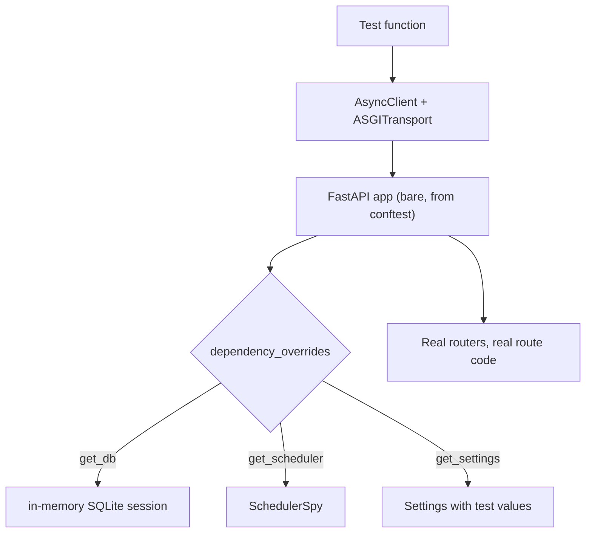

# 13 — Testing philosophy

Directory: `tests/`. 53 tests, under a second, no Postgres, no network. This chapter is
about how that's arranged, and why each piece of the arrangement was chosen.

## The tests came first

Every one of the eight build tasks followed the same loop, spelled out in the plan with the
*expected failure message* written down in advance:

> Write the failing test → run it and confirm it fails with `ModuleNotFoundError: No module
> named 'app.config'` → write the minimal implementation → run it and confirm it passes →
> commit.

That middle step is the one people skip, and it's the one that matters. A test you've never
seen fail might be passing for the wrong reason — asserting nothing, testing a stub, or
silently skipped. Watching the specific expected failure proves the test is wired to the
thing you think it is.

You can still see the discipline in the shape of the suite: every module in `app/` has a
matching `tests/test_<module>.py`, and the assertions read like specifications rather than
implementation details.

## The layers, and what each replaces



The whole strategy: **keep all the real code, replace only what touches the outside world.**
Routes, schemas, validation, ownership checks, quota logic, SQL — all real. The database,
the scheduler, and the network are substituted.

## Substitution 1: SQLite instead of Postgres

```python
engine = create_async_engine(
    "sqlite+aiosqlite://",
    connect_args={"check_same_thread": False},
    poolclass=StaticPool,
)
```
`tests/conftest.py:26-30`

`sqlite+aiosqlite://` with no path is an **in-memory** database — it exists only in RAM and
vanishes when the connection closes. That last detail is the catch: normally each new
connection gets its own separate empty database. `StaticPool` forces every connection to be
*the same* connection, so the schema created in the fixture is the schema the test sees.

Then:

```python
@event.listens_for(engine.sync_engine, "connect")
def _enable_fks(dbapi_connection, _record) -> None:
    dbapi_connection.execute("PRAGMA foreign_keys=ON")
```
`tests/conftest.py:32-34`

> 🔑 **Decision: foreign key enforcement is explicitly switched on.** SQLite ships with
> foreign keys **disabled by default** — it accepts `ondelete="CASCADE"` in your schema and
> then ignores it.

Without that pragma, chapter 04's cascade-delete tests would pass while testing nothing at
all. They'd delete a monitor, find no error, and conclude the cascade worked — when in
reality SQLite silently left orphaned rows behind and Postgres would behave completely
differently. Four lines that prevent a whole category of false confidence.

This is the general hazard of testing on a different database than you deploy to, and it's
the price paid for the speed. The mitigations are this pragma, the `JSONVariant` from
chapter 04, and — for anything subtle — verifying the generated SQL against both dialects,
which chapter 14 does.

## Substitution 2: `SchedulerSpy` instead of APScheduler

```python
class SchedulerSpy:
    """Records scheduler calls made by API routes (no real APScheduler)."""
    def __init__(self) -> None:
        self.synced: list[tuple[int, bool, int]] = []
        self.removed: list[int] = []

    def sync_monitor(self, monitor_id, *, is_active, interval_seconds) -> None:
        self.synced.append((monitor_id, is_active, interval_seconds))

    def remove_monitor(self, monitor_id: int) -> None:
        self.removed.append(monitor_id)
```
`tests/conftest.py:48-61`

> 🔑 **Decision: API tests assert the routes' *intent*, not APScheduler's behavior.**

When testing `POST /monitors`, the question is "did the route tell the scheduler the right
thing?" — not "does APScheduler work?" (it does; that's its maintainers' job) and certainly
not "did a job fire?" (which would mean waiting 60 seconds).

So the assertion is exact and instant:

```python
assert scheduler_spy.synced == [(body["id"], True, 300)]
```
`tests/test_monitors_api.py:35`

One monitor, active, 300-second interval. If a refactor accidentally synced twice, or
passed the interval where the boolean goes, that list comparison catches it.

The spy is possible *only* because chapter 10 made the scheduler a dependency. A route that
reached for a global scheduler could not be tested this way.

APScheduler itself is still tested — in `tests/test_scheduler.py`, against the real class,
where that's the subject.

## Substitution 3: the network

Two different fakes, for two different directions.

**Outbound** (chapter 07's probes) uses `httpx.MockTransport`: you hand `httpx` a plain
Python function that returns a response instead of a socket. A server that times out
becomes one `raise httpx.TimeoutException(...)`. Every branch of `perform_check` —
including DNS failures and timeouts, which are genuinely hard to arrange for real — becomes
trivially reachable. The fixture's docstring: *"httpx client whose transport is a local
handler — no real network."*

**Inbound** uses `ASGITransport`:

```python
transport = ASGITransport(app=app)
async with AsyncClient(transport=transport, base_url="http://test") as c:
    yield c
```
`tests/conftest.py:87-89`

The test client speaks to the app *in the same process*, with no TCP socket and no server.
`await client.post("/monitors", ...)` runs the entire real request pipeline — routing,
dependency resolution, validation, the route body, serialization — and returns a real
response object. That's why these tests are both realistic and sub-millisecond.

## `dependency_overrides`: the swap

```python
application.dependency_overrides[get_db] = _get_test_db
application.dependency_overrides[get_scheduler] = lambda: scheduler_spy
```
`tests/conftest.py:80-81`

> ⚙️ **FastAPI note:** `dependency_overrides` is a dictionary mapping a dependency function
> to a replacement. Routes don't know or care. No monkeypatching, no import interception, no
> global state — the substitution is scoped to one app object and disappears with it.

This is the mechanical payoff of every "make it a dependency" decision in chapters 05, 10
and 12. And it works per-test: `tests/test_monitors_api.py:72` overrides `get_settings`
inside a single test to shrink the quota to 2, so the quota test needs three requests
instead of twenty-one.

Note that the `app` fixture builds a **bare** `FastAPI()` and includes the routers manually
(`tests/conftest.py:72-74`) rather than calling `create_app()`. That skips the lifespan
entirely — no real engine, no real scheduler — which is what makes these tests fast. The
trade-off is that the *wiring itself* goes untested here, which is exactly the gap the
smoke test fills.

There's a maintenance note hiding in that choice: a new router must be registered in **two**
places, `create_app()` and this fixture. (Adding a route to an *existing* router, like
chapter 14's stats endpoint, needs no change — the fixture already includes that router
object.)

## The one test with no overrides

```python
def test_app_boots_serves_and_shuts_down(tmp_path, monkeypatch) -> None:
    db_url = f"sqlite+aiosqlite:///{tmp_path / 'smoke.db'}"
    monkeypatch.setenv("DATABASE_URL", db_url)
    get_settings.cache_clear()
    ...
    with TestClient(app) as client:  # runs lifespan: scheduler really starts
```
`tests/test_app_smoke.py:12-29`

> 🔑 **Decision: exactly one end-to-end test, running the real `create_app()` with the real
> lifespan.**

Everything the other tests deliberately skip, this one exercises: the engine really gets
built through `build_engine`, the scheduler really starts on the event loop, `app.state`
really gets populated, and shutdown really runs. Then it does a full user journey —
register, get a key, create a monitor, list it.

It costs more than the others (it hits a real file, boots a real scheduler), which is why
there is one of it rather than fifty. That's the right ratio: many fast tests for logic,
one slow test proving the parts are actually connected. Without it, every unit test could
pass while the app failed to start.

Note `get_settings.cache_clear()` before *and* after (`:15`, `:47`) — chapter 03's cache
would otherwise leak this test's `DATABASE_URL` into others.

## <a id="war-story-c4"></a>💥 War story C4: the deprecated constant

**Commit `0c9e939`.**

Small, but it makes a point. Starlette 1.4.1 renamed `HTTP_422_UNPROCESSABLE_ENTITY` to
`HTTP_422_UNPROCESSABLE_CONTENT` (following RFC 9110). The old name still worked — it just
emitted a `StarletteDeprecationWarning`. Same number, same behavior, zero user impact.

It was fixed anyway, immediately.

> **The lesson: treat new warnings as failures.** A suite with one ignored warning becomes a
> suite with forty ignored warnings, and the one that actually mattered is invisible in the
> pile. The discipline is cheap while the count is zero and expensive to restore later.

This suite currently has exactly one warning — a `StarletteDeprecationWarning` from
importing `fastapi.testclient` itself, which is upstream and not fixable here. Everything
else is clean, and the standing rule during the stats work was that no *new* warning may
appear.

## Reading a test as documentation

Test names in this suite are sentences, and the tricky ones carry docstrings explaining the
bug they prevent:

```python
async def test_patch_explicit_null_is_ignored_not_applied(client, auth_headers) -> None:
    """Explicit JSON null must be treated like an omitted field, not a value
    to set — str(None) previously corrupted the url column and broke every
    subsequent read of the monitor."""
```
`tests/test_monitors_api.py:159-164`

Someone deleting that test in a cleanup would have to read why it exists first. When you
fix a bug in this codebase, write the test this way.

### 🔍 Try it

1. **See the speed for yourself, and where it goes:**

   ```bash
   pytest --durations=5
   ```

   The slowest test is the smoke test. Everything else is noise-level.

2. **Break the FK pragma and watch a real test go quiet.** Comment out lines 32–34 of
   `tests/conftest.py` and run `pytest tests/test_models.py -v`. If a cascade test still
   passes, ask what it was actually verifying. Restore with `git checkout tests/conftest.py`.

3. **Watch the spy catch a mistake.** In `app/routers/monitors.py:99-103`, swap the
   `is_active` and `interval_seconds` arguments to `sync_monitor`... except you can't — the
   keyword-only `*` (chapter 02) makes it a syntax-level impossibility. Instead, change
   `monitor.is_active` to `True` and run
   `pytest tests/test_monitors_api.py -k inactive -v`. Restore afterward.

4. **Run one test with maximum noise** to see the whole pipeline:

   ```bash
   pytest tests/test_monitors_api.py -k schedules_job -vv -s
   ```

---

Previous: [12 — Lifespan: assembly](12-lifespan-assembly.md) · Next: [14 — Case study: the stats endpoint](14-case-study-stats.md)
